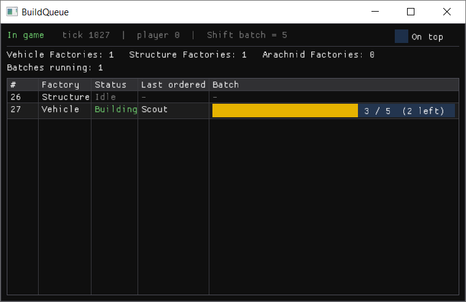

# BuildQueue-UI

A small **Dear ImGui** desktop window that shows the [BuildQueue](../README.md)
module's factories and batches **live**, next to Outpost 2 (OPU 1.4.1).



## What it shows

- **Status:** waiting for Outpost 2 / Outpost 2 running, start a game / in game (with the mark -
  the game's clock, 100 ticks - local player and the Shift batch size) / paused or not in a game (tick not moving) /
  game closed.
- **Counts:** how many factories of each enabled kind you have, and how many batches are running.
- **One row per factory of an enabled kind:** unit number, kind, Building / Idle, the last unit
  you ordered there (with its weapon), and the Shift + BUILD IT batch as a bar
  (`3 / 5 (2 left)`).
- **On top:** keeps the window above the game.

Only the factory kinds BuildQueue has batches switched on for are counted and listed - by
default Vehicle and Arachnid Factories. The app reads no ini: BuildQueue.dll reads its
`[BuildQueue] VehicleFactory / ArachnidFactory / StructureFactory` settings at startup and sends
them in every snapshot, so the view always matches what the running game uses.

"Last ordered" is what BuildQueue saw you order at that factory this game - not read from the
factory itself.

## How it gets the data

BuildQueue.dll, inside the game, writes a snapshot every 4 game cycles into the named shared
memory `Local\OP2BuildQueue`. This app opens it **read-only** and copies it about 10 times a
second:

1. The layout is in [`..\bq_shared.h`](../bq_shared.h), included by both
   sides. Its version number must match, or the app says to rebuild both.
2. A counter (`seq`) is odd while the game is writing. The app keeps a copy only if `seq` was even
   and unchanged across the copy, so it never shows a half-written snapshot.
3. Nothing goes back to the game, and the game never waits on the app - start and close it any
   time. With no game running it just waits.

## Quits with the game

The snapshot carries the game's process id. Once the app has seen a game it closes itself when
Outpost 2 exits - a normal quit or a crash - or when BuildQueue reports the game shutting down.
Started before the game, it waits for one.

## Use

1. Install BuildQueue in the game (see its README) - the feed is part of `BuildQueue.dll`.
2. Run `BuildQueue-UI.exe` (from anywhere), before or after starting the game.

## Build

```
build.bat
```
Finds Visual Studio via `vswhere` and builds `BuildQueue-UI.exe` (64-bit, Direct3D 11, static
CRT - no extra DLLs needed).

## Files

| File | |
|---|---|
| `main.cpp` | The app (fully commented). |
| `build.bat` | Build script. |
| `app.rc`, `Tech_Vehicle.ico` | The app icon (window, taskbar and the .exe). |
| `BuildQueue-UI.exe` | Built app. |
| `imgui\` | Dear ImGui 1.91.5 (core + Win32/DX11 backends), MIT licence - `imgui\LICENSE.txt`. |
