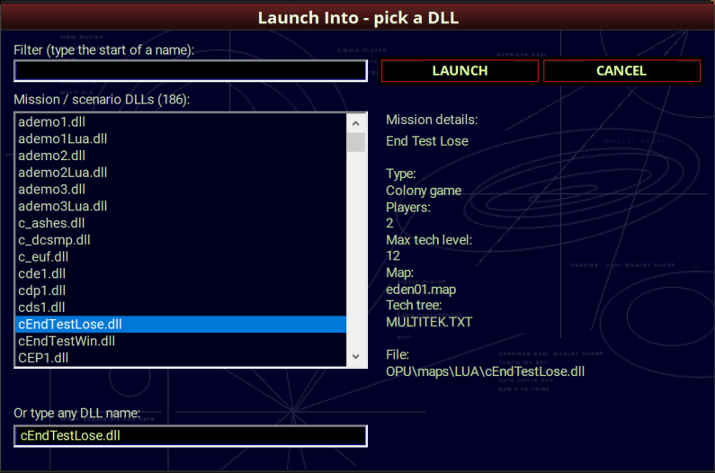

# Launcher

An **op2ext module** for Outpost 2 (OPU 1.4.1) that boots the game **straight into any
mission/scenario/colony DLL** - by filename, with no menu navigation and no keystroke automation.
It can auto-launch a DLL named in `outpost2.ini`, or pop a picker that lists every mission DLL the
game can load (and lets you type any name). The list covers the `Outpost2.exe` folder, the OPU
folder and every subfolder of `OPU\base\maps\` and `OPU\maps\` (where OPU keeps most missions),
keeping only DLLs that export `DescBlock` and each name once - the same list as the game's own
"PICK A SCRIPT" dialog. A **Filter** box at the top (focused when the picker opens) narrows the
list as you type to the missions whose name starts with the text; Enter launches the typed name,
the selection, or the only match left. When an entry stays selected for half a second, the panel
under LAUNCH / CANCEL shows the mission's details, read from the DLL's exports without loading it:
its name (`LevelDesc`), type, players and max tech level (`DescBlock`), map (`MapName`), tech tree
(`TechtreeName`) and where the file is.

This replaces the brittle "send `d`,`r`,`c`,Enter to the debug menu" approach (which can only
start whatever the debug menu happens to enumerate). Launcher can load **any** DLL.

> The op2ext module DLL is **`Launcher.dll`** (its op2ext module name is **`Launcher`**), and it
> sits directly in the OPU folder (`D:\Outpost 2\OPU\Launcher.dll`). Was previously `LaunchInto` /
> `op2mod.dll` in an `OPU\LaunchInto\` sub-folder.

## How it works

Launcher reuses the engine's **own** debug-menu launch path (the in-game "PICK A SCRIPT" dialog),
which is why it boots cleanly. That path is a **two-step** sequence, and getting only the first step
is what made early attempts load the DLL but never render:

1. **`TApp::OnLoadScript(char* scriptName)`** @ `0x00487590` - builds a `GameStartInfo` from the
   name (a non-NULL name is used verbatim; the engine reads `numPlayers`/map/techtree from the
   DLL's own `DescBlock`) and calls `TethysGame::StartGame`. This sets up the game *state*.
2. **`TApp::ActivateGame()`** @ `0x00486F40` - switches `TApp.activeFrame` (`+0x44`) to the in-game
   frame `Dans_RULE_UIFrame` (`@ 0x005756C0`). **This is the step that makes the game render/run.**
   There is one `TApp::Run` message pump (`@ 0x00486650`); it only drives the game once
   `activeFrame` is the game frame. A bare `StartGame`/`StartSingleGame` call omits this.

This mirrors the OP2Shell.dll handler for "PICK A SCRIPT" (state `0x733`): build GameStartInfo ->
`StartSingleGame` -> on success `ActivateGame`. We feed `OnLoadScript` an arbitrary DLL instead.

Underlying fact: the mission DLL is just `GameStartInfo.scriptName[32]` (offset 0x10); the engine
only rewrites it for **campaign** games (`E01.DLL`/`P01.DLL`), otherwise it is used verbatim and
loaded by `GetModuleDesc` with no name validation.

Key engine facts (OPU 1.4.1; same addresses as retail 1.3.6, which is an in-memory patch base):

| Symbol | Address |
|---|---|
| `void __thiscall TApp::OnLoadScript(char*)` | `0x00487590` |
| `int  __thiscall TApp::ActivateGame()` | `0x00486F40` |
| `bool __thiscall TethysGame::StartGame(GameStartInfo*)` | `0x004893B0` |
| global `TApp app` (the `this` for OnLoadScript/ActivateGame) | `0x0056E868` |
| in-game frame `Dans_RULE_UIFrame` | `0x005756C0` |
| `Outpost2.exe` image base (fixed, not ASLR) | `0x00400000` |

(Verified against OP2Internal and the code of `Outpost2.exe` and **op2shell**.) See
[`engine.h`](engine.h) for the calls.

> **Gotcha that cost a day:** the picker dialog must NOT call `PostQuitMessage` on close. It runs
> inside OP2's own message thread; a stray `WM_QUIT` lingers in the queue and terminates `TApp::Run`
> seconds later (the game loads, then the app silently exits). The picker's modal loop exits via a
> flag instead.

The trigger uses a thread-local `WH_GETMESSAGE` hook installed from `InitMod` (which op2ext calls on
the main thread). When a visible top-level window on that thread appears (the shell) and has settled,
the hook fires once, then either auto-launches the configured mission or shows the picker - both on
the main thread, where a real menu click would have called StartGame.

### Loading a saved game

`[Launcher] Load=<save>` (set by `op2launcher.exe --load <save>`) loads a saved game instead of
starting a mission; the module clears the key once used. It follows the shell's own Load button
(OP2Shell.dll 0x130082B3): the file name goes to `TApp +0x5C` (where `TApp::GetLoadName`'s dialog
puts it), then `TApp::OnLoadGame` @ `0x004874F0` (loads the sprite sheets, then
`TApp::LoadGame(TApp +0x5C)` @ `0x004878F0`), then `ActivateGame` when it returned nonzero.
Calling `TApp::LoadGame` alone from the shell skips the sprite sheets and the game crashes drawing
its first frame (Outpost2.exe +0x3DC4, `Viewport::MarkBackgroundRectToRedraw`), which is also what
`Outpost2.exe /noshell /map <save>` does under OPU 1.4.1. A save made by a Lua mission loads with
its script carrying on under OP2Lua 0.8.8 and later, which keeps the script's state in the save.

## Files
The op2ext module (`Launcher.dll`):
- [`engine.h`](engine.h) - the engine calls we use: `OnLoadScript` + `ActivateGame` (+ `StartGame`).
- [`launcher.cpp`](launcher.cpp) - DllMain, `InitMod`/`DestroyMod`, ini config, the trigger hook, the launch, one-shot self-disable.
- [`picker.cpp`](picker.cpp) - the "pick a DLL" dialog (real `DialogBox`, see skinning note below):
  finding the missions, the filter, and the details panel (`PeFile` reads a DLL's exports straight
  from the file).
- [`picker.rc`](picker.rc) + [`resource.h`](resource.h) - the dialog template (no `WS_SYSMENU`, so no title-bar icon).
- [`build.bat`](build.bat) - x86 build to `Launcher.dll` (compiles `picker.rc`), auto-deploys to `D:\Outpost 2\OPU\`.

The front-end console app `op2launcher.exe` (`../exe/`, cross-platform - Windows native + Linux/Wine):
- [`../exe/op2launcher.cpp`](../exe/op2launcher.cpp) - the source. Installs `Launcher` into
  `outpost2.ini` if missing, sets the target DLL (or `--picker`) + starts OPULauncher, and
  `--uninstall` removes it again.
- [`../exe/launcher.rc`](../exe/launcher.rc) + [`../exe/ConVec.ico`](../exe/ConVec.ico) - the exe icon (ConVec) + version info (FileDescription `OP2Launcher`, CompanyName `Outpost Universe`).
- [`../exe/op2launcher.ini`](../exe/op2launcher.ini) - optional config (a default DLL for no-arg runs).
- [`../exe/build.bat`](../exe/build.bat) - Windows x86 build of `op2launcher.exe` (auto-deploys to the OPU folder).
- [`../exe/build.sh`](../exe/build.sh) - Linux build (`g++`) of `op2launcher`; OPU runs under Wine.

### Picker skinning (the OP2 look)



The picker is a normal Win32 dialog, but it comes out looking like the engine's own "PICK A SCRIPT"
dialog (navy caption, red-bordered buttons) because we bracket `DialogBoxParam` with OP2's own skin
engine, **odasl** (the same pattern its SDK uses):
```cpp
wplEnable();   // odasl skin on  (GetProcAddress from the already-loaded odasl.dll)
DialogBoxParamA(self, IDD_PICKER, FindWindow("Outpost2Shell",0), DlgProc, 0);  // self = Launcher.dll
wplDisable();  // skin off
```
`OP2Shell.dll` imports + initialises `odasl.dll` in-process, so its `WH_CBT` hook auto-skins any
`#32770` dialog created while enabled - we don't owner-draw anything. odasl paints its own caption,
so dropping `WS_SYSMENU` from the template leaves a clean title with no Windows icon.

Two skin quirks the details panel works around:
- **Don't change a skinned label's text.** `WM_SETTEXT` makes a static repaint itself at once with
  plain Windows drawing (white background), bypassing the skin, and nothing erases the old text, so
  the end of a longer previous line shows through. The details lines are therefore separate labels
  that are **destroyed and re-created** for each mission. Destroying one makes the dialog repaint its
  background there. The new ones are created after odasl skinned the dialog, so the dialog answers
  their `WM_CTLCOLORSTATIC` itself: transparent (hollow brush) in the skin's label colour.
- **Alt.** The first Alt press switches on keyboard cues and repaints every label in plain Windows
  style. `WM_INITDIALOG` sends `WM_CHANGEUISTATE(UIS_CLEAR, UISF_HIDEACCEL | UISF_HIDEFOCUS)`, so
  the cues are on from the start and Alt changes nothing.

## Build
```
build.bat                 (the module -> Launcher.dll)
..\exe\build.bat          (-> op2launcher.exe, with ConVec icon + version info)
```
The module is 32-bit (static CRT) and auto-deploys to `D:\Outpost 2\OPU\Launcher.dll`; the launchers
deploy next to `OPULauncher.exe`. Requires the Visual Studio C++ x86 toolchain (Linux: `build.sh`).

## Install / configure

The OPU runtime dir is **`D:\Outpost 2\OPU`** (OPULauncher's ini; the root `D:\Outpost 2\outpost2.ini`
is the dead, unpatched GOG copy and is never loaded). The easiest install is to drop `Launcher.dll` +
`op2launcher.exe` in `D:\Outpost 2\OPU` and run `op2launcher.exe <dll>` - it registers the module in
the ini itself. To do it by hand, put `Launcher.dll` in `D:\Outpost 2\OPU` and add to
`D:\Outpost 2\OPU\outpost2.ini`:

```ini
[ExternalModules]
OpuPatch=yes
NetHelper=yes
Launcher=yes            ; op2ext's "load this module" flag (set once, leave it)

[Launcher]
Dll=Launcher.dll
Enabled=0               ; THE on/off:  1 = active,  0 = loaded but does nothing (clean play)
Mission=                ; the DLL to boot into (when Auto=1)
Auto=0                  ; 1 = launch Mission on startup; 0 = show the picker
OneShot=0               ; 1 = set Enabled=0 again after an auto-launch (one-shot)
PlayerName=DevBox
GameSpeed=8             ; gameSpeed4X, roughly 4..40
```

### Enable / disable

There are two keys, one job each:

| Key | Section | Values | Job |
|---|---|---|---|
| `Launcher` | `[ExternalModules]` | `yes` / `no` | op2ext's **load** flag - whether `Launcher.dll` is loaded at all. Set it `yes` once and leave it (op2ext's own mechanism, the same `yes/no` every OPU mod uses; it is not `1/0`). |
| `Enabled` | `[Launcher]` | `1` / `0` | the **everyday on/off**. `1` = the picker / auto-launch runs; `0` = the module loads but does nothing, so normal play is untouched. |

So: keep `[ExternalModules] Launcher=yes`, and flip `[Launcher] Enabled=1/0` for on/off. (Setting
`[ExternalModules] Launcher=no` fully unloads the module - the bigger hammer.) The launchers set both
for you, and the **one-shot** flips `Enabled` back to `0` after launching - so it is never left on by
accident.

### Launching a DLL - two ways

1. **`op2launcher.exe <dll>` (recommended - installs + launches).** Drop `Launcher.dll` +
   `op2launcher.exe` in the OPU folder and run it. On first run it registers `Launcher` in
   `outpost2.ini`, then sets `Enabled=1` + `Mission=<dll>` + `Auto=1` + `OneShot=1`, starts
   OPULauncher, and the module boots straight into the DLL and one-shots `Enabled` back to `0`.
   ```
   cd "D:\Outpost 2\OPU"
   op2launcher.exe e04.dll      (install if needed + boot straight into e04.dll)
   op2launcher.exe --picker     (boot into the in-game "Launch a DLL" picker menu; Auto=0)
   op2launcher.exe --load saves\SGAME0.OP2   (boot into a saved game; relative to the OPU folder or absolute)
   op2launcher.exe --uninstall  (remove Launcher from outpost2.ini; leaves Launcher.dll on disk)
   ```
   `--picker` just sets `Enabled=1` + `Auto=0` + `OneShot=1` (no `Mission`), so the picker shows
   once and the module disables itself afterward - same one-shot behaviour as an auto launch.
2. **Manual ini.** Set `[ExternalModules] Launcher=yes` + `[Launcher] Enabled=1`, then `Auto=1` +
   `Mission=<dll>` to boot straight in, or `Auto=0` to get the picker each launch.

`op2launcher.exe` is cross-platform: `build.bat` builds the Windows exe (with the ConVec icon +
version info); `build.sh` builds a Linux binary that runs OPU under **Wine** (`wine OPULauncher.exe`).
Same usage on both.

The module reads its target only from `[Launcher] Mission=` (+ `Auto`) in `outpost2.ini` - the
launcher is the thing that sets it.

Paths are resolved from the **current directory** (OPULauncher runs the game with cwd = the OPU
runtime dir, where op2ext reads `outpost2.ini` and writes `Outpost2Log.txt`), NOT from the raw
`Outpost2.exe` folder in the root (that's the dead, unpatched GOG copy). A log is written to
`<OPU>\logs\Launcher.log` (load, resolved dir/ini, config, the detected shell window,
and the launch sequence).

## Status / notes
- **Working** - boots OPU 1.4.1 straight into an arbitrary mission/scenario/colony DLL, both via the
  picker and via `op2launcher.exe` (verified live with `e0x.dll`, `t14.dll`, smoke-test DLLs).
  `Launcher.log` records each launch; "Could not load script file" in-game means the DLL name was
  wrong or it lacks the required exports.
- **`op2launcher.exe` first-run self-install verified** - run against an ini with no `Launcher`
  entry, it prints "Installing Launcher into outpost2.ini (first-time setup)...", creates
  `[ExternalModules] Launcher=yes` + a default `[Launcher]` section, boots into the DLL, then the
  one-shot resets `Enabled=0`. So a fresh `Launcher.dll` + `op2launcher.exe` in the OPU folder is a
  complete, self-registering install. `--uninstall` removes it again (DLL kept).
- The picker is a real `DialogBox` skinned to the OP2 look by bracketing it with odasl's
  `wplEnable()`/`wplDisable()` (see "Picker skinning").
- Multiplayer / network launch is out of scope here (that path needs the full per-player
  `GameStartInfo` the lobby builds). Single-player / campaign / colony / tutorial DLLs all work.
