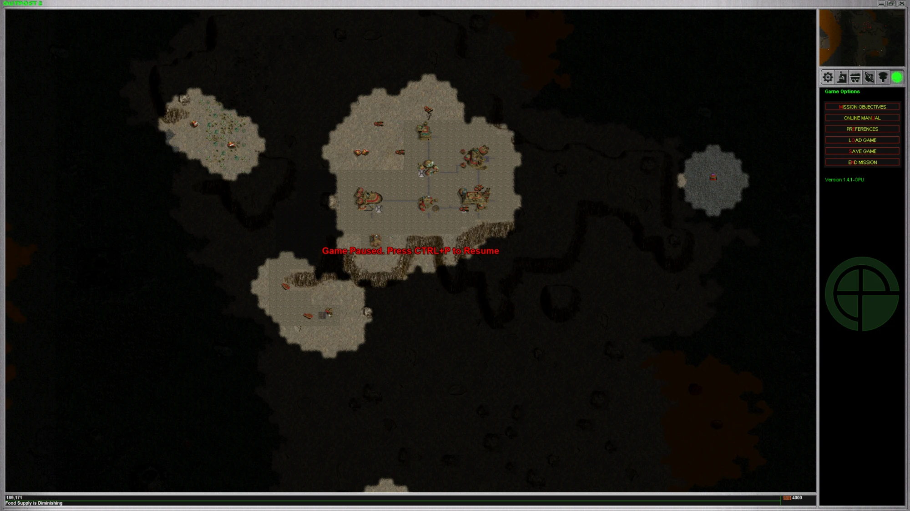

# Zoom (Zoom.dll)

An **op2ext addon** that adds a **new, wider main-view zoom level** for Outpost 2 - wider than the
engine's current widest - so the map viewport shows **more map**. Render/UI-only, so it is
**multiplayer-desync-safe**. For OPU 1.4.1.



*Zoomed all the way out at **2x** on a maximized window (Colony Builder - Eden, Starship): twice the
map width and height of the game's normal widest zoom, with the side panels unchanged.*

## Why it isn't a one-line clamp change

The engine's zoom is an integer **divisor**: `AllocSurface @ 0x004A9170` builds the map back-buffer at
`(clientW / zoom) x (clientH / zoom)`, and the present `@ 0x004A9410` blits it scaled **up** by `zoom`
(`StretchDIBits`, or `BitBlt` 1:1 when `zoom == 1`). So `zoom = 1` is already the widest the divisor
can express. Seeing **more** needs an effective **sub-1** scale: a back-buffer **larger** than the
window, **shrunk** on present, with the screen<->world math scaled to match.

## How it works

Engine `zoom` stays `1`; the wide level is gated on `[Game] WideZoom` and engages when you zoom all
the way out to level 1. Five in-memory, reversible hooks and patches (no `Outpost2.exe` edit):

1. **`GetClientRect` (IAT)** - returns `client x scale` **only for the map callers**, scoped by
   caller return address: the back-buffer alloc `FUN_0049d030` (only when the surface is large, so the
   *shared* minimap/command-pane allocs are left alone) + the view transforms `FUN_00407990` /
   `FUN_00408210` / `FUN_004082f0` / `FUN_00408370` / `FUN_00408540`. The panel-layout caller
   `FUN_004999a0` (reads the **main** window and right-aligns the sidebar) stays truthful, so the
   **side panels keep their place**. The map subsystem reads a different window (~800x608 detail) than
   the layout (full game window).
2. **`BitBlt` (IAT)** - when the source bitmap is **our over-sized detail buffer** (the exact size the
   alloc hook handed out, +/-32 px) and wider than its destination window, the mod shrinks that dirty
   rect itself: it resamples straight from the buffer's DIB bits into its own window-sized DIB, then
   presents with a plain 1:1 `BitBlt` (the vanilla zoom-1 fast path). One **global** source mapping is
   used for every rect, so a redrawn tile always matches its neighbours (GDI `StretchBlt` per rect
   shimmered and cost 25-33% of each second). With `ZoomSmooth=1` (default) each screen pixel is the
   **average** of the block it covers, so 1 px lines stay continuous; `ZoomSmooth=0` copies the nearest
   pixel (sharper, cheaper, thin lines break up). Any other bitmap is passed through untouched; a
   non-DIB or unexpected format falls back to `StretchBlt` (logged once).
3. **`ScrollWindowEx` (IAT)** - `ScrollScreen` (`0x004A9890`) shifts the on-screen picture by the
   scroll distance in **buffer** pixels, ~2x too far on the shrunk view. At the wide level the mod
   skips that shift and repaints the whole view from the (already scrolled) buffer instead.
4. **Mouse: `IWnd::Pane::Detail::GetAbsolutePos` (vtable slot 10)** - the map mouse position
   (`0x0057B7B4`) is client pixel -> map pixel through `GetAbsolutePos` (`0x00408070`). The mod
   replaces the pane vtable's slot 10 (`0x004CF5E8`, the function's only reference; verified before
   patching) with a wrapper that scales the client pixel by the scale while wide-active. Both callers
   go through it: `Detail::CallFilters` (`0x00407A50`, each mouse message's `lParam`) **and**
   `Dans_RULE_UIFrame::OnIdle` (`0x0049C310`), which re-reads the cursor with `GetCursorPos` **every
   frame**. Scaling `lParam` in the window procedure (the old approach) missed the `OnIdle` path, so
   the map position was overwritten unscaled each frame and a selection box's moving corner sat at
   cursor / scale (Test 10). Mouse messages themselves are passed through unchanged.
5. **Detail-window subclass** - a 250 ms timer that repaints the whole view from the buffer once a
   second (a safety net for stale screen pixels), and the `ZoomStats` click diagnostics.

**The 400-byte limit.** `Viewport::SetSurface` (`0x0046F160`) sizes five per-tile redraw bit
vectors from the surface size, but in the vanilla engine each is a fixed `bitVectorBuf[400]` inside
the `Viewport`. A bigger surface overruns them into the pointers after them and crashes at
`0x0046F26C` (e.g. a ~990x700 view at exactly 2x needs 414 bytes). `SetSurface` is the only code
that takes those arrays' addresses (every `lea` in `.text` checked); everything else uses the
pointers at `+0x804..+0x814`. So the limit can be lifted:
- **Under OPU 1.4.1** (the supported version): OPUPatch already hooks `SetSurface` (a `jmp` at
  `0x0046F1D2`, where the redraw vector pointer is stored) and supports larger vectors - its
  `ForceFullRedraw` also depends on that hook. The mod leaves `SetSurface` to OPU and simply drops its
  own cap. The only remaining caps are sanity ones (buffer <= 16 Mpx, vectors <= 64 KB), so the full
  `ZoomWiden` scale is used - e.g. **2x (3648x2176)** for a maximized 1824x1088 view.
- **Without OPUPatch**, or with `ZoomBigView=0`, the cap stays: the mod picks the largest scale (1/16
  steps) whose vectors fit 400 bytes, e.g. x19/16 for 1824x1088 or x31/16 for 992x704, logged as
  `reduced to fit ...`.

**Small maps cap the zoom-out.** The engine assumes the view is smaller than the map, so the scale
is also limited per map (largest 1/16 step that fits both rules):

- **Height/width inside the map, with a 3-tile margin.** The tile loops (e.g.
  `MarkAnimatedTilesForRedraw`, `0x0046FF80`) cover `((h + 31) >> 5) + 1` rows and read past the map
  when the view is taller than it - the tutorial crashed at `+0x7000A` that way. A view just 1-2
  tiles inside the map still crashed, hence the margin. Map size: tiles at `0x0054F808` (width) and
  `0x0054F810` (height).
- **Width under half the map's wrap width** (minus 64 px). Object positions relative to the view
  are folded modulo the wrap width (pixel mask `0x0054F7FC`) into +/- half of it, so on a view wider
  than that, objects on the far side are culled - at 1.75x on the tutorial whole structures went
  missing.

The engine does **not** re-allocate the view when a mission loads, so the buffer would keep the size
chosen for the previous map (or the menu). When the view transforms see a map whose cap gives a
different scale, the mod posts a `WM_SIZE` to the detail window, and the engine re-allocates before
the first present. Result: large maps get the full `ZoomWiden` (2x); the tutorial map (4096 px wrap
width) gets **x17/16 (~1.06x)** on a maximized 1824x1088 view.

Each mission load logs which mission DLL was loaded and the scale chosen for its map:

```
MISSION: <mission>.dll - "<LevelDesc>"
ZOOM LEVEL: <scale> (max <ZoomWiden>) - map <w>x<h> tiles, view <w>x<h>[, capped by map size]
```

The mission is found as the loaded module exporting `DescBlock` and `InitProc` (every mission DLL
does); `LevelDesc` is its display name. `ZOOM LEVEL` is written again whenever the scale changes.

Missions can be exited and another loaded without restarting the game, so the check runs **per
mission**, not just per map size: the mod hooks `Outpost2.exe`'s `LoadLibraryA` import, which
`LevelDLL::LoadScript` (`0x00402B20`) uses for new and saved games alike. Each mission DLL load
re-checks the scale for the new map (re-sizing up or down as needed, also after a map that got
1.00x) and writes its own `MISSION` / `ZOOM LEVEL` lines, even when the map size is unchanged.

At load it **verifies** the present / `AllocSurface` prologue bytes against the expected
`Outpost2.exe` code and logs a `MATCH`/`DIFFER` line, plus the live `zoom` global. If **either** differs it installs **no
hooks** and the game runs with vanilla zoom - a wrong build is detected, never corrupted. The
`BitBlt` hook goes in first and `GetClientRect` only after it, so the over-sized buffer is never
built without the shrink that undoes it. It also runs a read-only zoom-watcher that logs each zoom
change.

**Game folder.** Settings are read from, and the log written to, the game's runtime folder: the
OPU folder (OPULauncher starts the game with it as the current directory). Log:
`<game folder>\logs\Zoom.log`, with timestamps.
With `[Zoom] Debug=0` (default) the log is short: the settings, whether the hooks went in, and
the `MISSION` / `ZOOM LEVEL` lines for each mission, plus any errors. `Debug=1` adds the
diagnostics: engine byte checks, `GetClientRect` callers, buffer allocations and re-sizes,
present/shrink details, scroll repaints and zoom changes.

## Install

Outpost 2 with **OPU 1.4.1** (op2ext loads modules from `[ExternalModules]`): copy `Zoom.dll` into
the OPU folder (next to `OPUPatch.dll`) and add to the OPU folder's `outpost2.ini` (the live one - not the
`outpost2.ini` next to the GOG `Outpost2.exe`):

```ini
[ExternalModules]
Zoom = yes

[Zoom]
Dll = Zoom.dll
Debug = 0                    ; 1 = full diagnostic log, 0 = short log (default)

[Game]
WideZoom   = 1               ; 1 = on (default), 0 = off
ZoomWiden  = 2               ; max scale 2..8; 2 = ~2x more map (reduced automatically to fit, see above)
ZoomSmooth = 1               ; 1 = averaged shrink (default), 0 = nearest pixel
ZoomBlit32 = 1               ; 1 = 32bpp screen copy (default, faster), 0 = 16bpp copy
ZoomBigView = 1              ; 1 = lift the engine's 400-byte limit (default), 0 = cap the scale to fit it
ZoomStats  = 0               ; 1 = log present statistics every 5 s (diagnostics)
```

To use it: start a game and **zoom all the way out** with the **-** button beside the minimap (zoom
level 1) - the view widens to show more map. Zoom back in (2/3) for vanilla behaviour.

## Build

```
build.bat        (x86 -> Zoom.dll; source op2zoom.c)
```

`build.bat` finds Visual Studio through `vswhere`: any edition with the C++ x86 tools, including
Build Tools and prerelease/Insiders builds.

Must be 32-bit - it patches the 32-bit `Outpost2.exe` in-process.

## Status / notes

- **Working on OPU 1.4.1** (live-tested from 2026-11-23, Tests 7-13): GOG install + OPU, maximized
  2024x1118 window; `Outpost2.exe` timestamp `34493B6A`. Loads via `[ExternalModules]` and reads
  `OPU\outpost2.ini`. Smooth frame rate, clean scrolling, sidebar/minimap untouched, mouse correct
  (drag-select, click, right-click-move).
- **Selection-box lines need `ForceFullRedraw=1`:** OPUPatch's `[Game] ForceFullRedraw=1` (written
  by default) redraws the whole view each frame, so white selection-box lines don't linger. Without a
  full redraw each frame (early tests) they stayed on screen until those units were deselected.
- **Cost with `ForceFullRedraw=1`:** every frame presents the whole buffer, so the mod shrinks all of
  it each frame. With the packed-pixel fast path for scales <= 2 (each block is 1 or 2 pixels per
  axis; `(a & b) + (((a ^ b) & M) >> 1)` averages all three channels of two 16bpp pixels at once,
  exact for 555 and 565) this measured **105-143 ms/s** at 1.19x (was 264-433 ms/s with the
  per-channel box filter). Of that only ~30-45 ms/s was the resample; ~75-108 ms/s was the final
  1:1 `BitBlt` (16bpp -> 32bpp screen conversion), which unmodded zoom 1 also pays.
- **32bpp copy (`ZoomBlit32=1`, default):** for a 16bpp buffer the mod's window-sized copy is 32bpp;
  each resampled pixel goes through a 65536-entry table that **GDI itself builds** (all 16bpp values
  blitted into a 32bpp DIB), so colours are exactly GDI's conversion. The final blit is then a plain
  32->32 copy: ~0.7 ms per Mpx instead of ~2.2; total ~2.0 ms per Mpx instead of ~3.1. In the test the
  game used the time to present ~2.4x more pixels per second. `ZoomBlit32=0` restores the 16bpp copy.
- **Full 2x on large windows (Test 11):** with the 400-byte limit lifted, a maximized 2024x1118 window
  on OPU 1.4.1 runs at **2x** (3648x2176 buffer; was capped at 1.19x) - smooth, no crash, and no
  lingering selection-box lines (OPU's `ForceFullRedraw`). Shrink cost ~340 ms/s at ~200 Mpx/s
  presented (~1.7 ms per Mpx).
- **Small maps (Test 12):** the zoom-out is capped per map (see *How it works*), so small maps such
  as the tutorial get less of it (~1.06x) - no crash, all structures drawn.
- **Activation** currently repurposes engine zoom level 1 (the widest). A future version could add a
  true 4th level + hotkey so vanilla zoom 1 stays reachable.
- **Edge/arrow scroll** uses `GetCursorPos` (not `lParam`), so it works at the wide level though the
  world step may feel different; revisit only if needed.
- Render/UI-only -> **MP-safe** (not a command packet; no simulation state touched).

## Key addresses (`Outpost2.exe`, OPU 1.4.1)

| What | Address |
|---|---|
| `zoom` global (`[Game] Zoom`) | `0x00576264` |
| `AllocSurface` (back-buffer factory) | `0x004A9170` |
| Present blit (`StretchDIBits` / `BitBlt`) | `0x004A9410` |
| Detail back-buffer alloc (`GetClientRect` -> AllocSurface) | `FUN_0049d030` |
| View transforms (clamp/centre/span/scroll) | `0x00407990`, `0x00408210`, `0x004082f0`, `0x00408370`, `0x00408540` |
| Panel layout (main window, right-aligns sidebar) | `FUN_004999a0` |
| Detail pane client pixel -> map pixel (`GetAbsolutePos`, vtable slot 10 @ `0x004CF5E8`) | `0x00408070` |
| Map mouse position global (`gameFrame.mapMousePos`) | `0x0057B7B4` |
| Per-frame cursor re-read (`GetCursorPos` -> `GetAbsolutePos`) | `Dans_RULE_UIFrame::OnIdle` `0x0049C310` |
| Minimap pixel -> map (not the detail pane; unaffected) | `MiniMap::PixelToMapLocation` `0x0048D930` |
| Game window HWND global | `0x005756C8` |
| `Viewport::SetSurface` (sizes the 400-byte tile bit vectors) | `0x0046F160` |
| `GFXClippedSurface::ScrollScreen` (`ScrollWindowEx`) | `0x004A9890` |
| Map width / height in tiles | `0x0054F808` / `0x0054F810` |
| Map x wrap mask in pixels (positions folded to +/- half of it) | `0x0054F7FC` |
| Tile loop that overruns on a view taller than the map | `MarkAnimatedTilesForRedraw` `0x0046FF80` |

Full reverse-engineering notes and the test-iteration log live alongside this README in this folder:
`FINDINGS.md` (how the zoom/render/coordinate code works), `PLAN.md` (approach + phases), and `TESTLOG.md`
(the live-test iterations).
